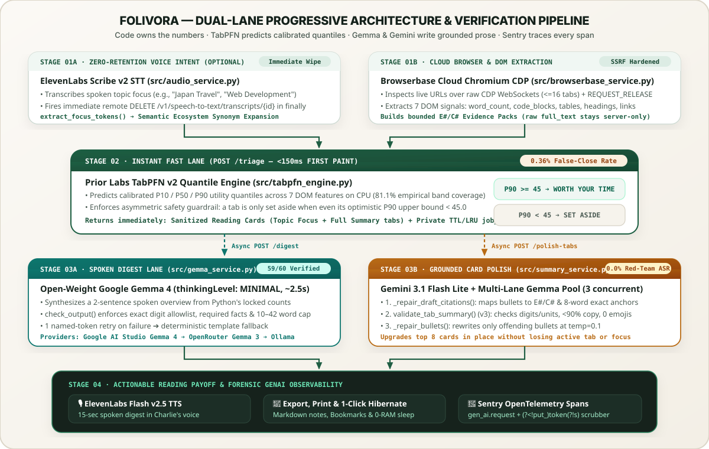
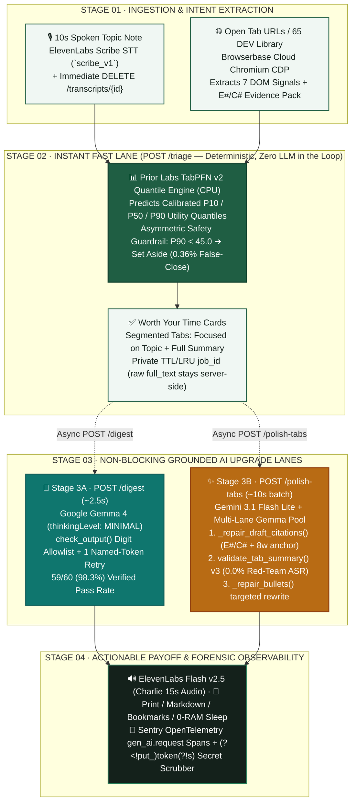

<div align="center">

<a href="https://folivora.tech" target="_blank">
  
</a>

# 🦥 Folivora

<a href="https://folivora.tech">
  
</a>

<p align="center">
  <!-- Tier 1: Stack & Engine -->
  
  
  
  
  
  
  
</p>

<p align="center">
  <!-- Tier 2: Verification & Empirical Proof -->
  <a href="tests/"></a>
  <a href="eval/EVAL.md"></a>
  <a href="eval/summary_quality.py"></a>
  <a href="eval/redteam_eval.py"></a>
  <a href="benchmarks/ablate.py"></a>
  <a href="LICENSE"></a>
</p>

<p align="center">
  <!-- Tier 3: Actionable CTAs -->
  <a href="https://folivora.tech" target="_blank">
    
  </a>
  &nbsp;&nbsp;
  <a href="https://folivora.tech/download-extension.zip">
    
  </a>
  &nbsp;&nbsp;
  <a href="eval/EVAL.md">
    
  </a>
  &nbsp;&nbsp;
  <a href="https://folivora.tech/docs" target="_blank">
    
  </a>
</p>

### *"Code owns the numbers. TabPFN predicts the utility distribution. Gemma and Gemini write the prose behind strict evidence gates. Sentry traces every token."*

<p>
  <b>Folivora</b> (Latin: both the biological suborder for tree sloths and <code>folium + vorare</code>, literally <b>"the page/folio devourer"</b>) is an open-source, evidence-first browser tab triage and section-anchored reading digest engine.<br/>
  <i>Designed as a calm editorial reading room for everyone—from travelers and shoppers to software engineers—powered under the hood by Browserbase Cloud Chromium (CDP), Prior Labs TabPFN calibrated quantiles, Multi-Lane Open-Weight Google Gemma 4 &amp; Gemma 3, ElevenLabs Scribe &amp; Flash v2.5, and Sentry OpenTelemetry Agent Tracing.</i>
</p>

</div>

---

## ⚡ The Problem vs. The Folivora Antidote

People don't keep 40 browser tabs open for three weeks to read 5,000-word articles from top to bottom. We keep them open because **five of those tabs contain a specific itinerary detail, benchmark comparison, recipe step, or 3-line CLI command** we were too busy to extract—and closing the window feels like throwing away work.

<table>
<tr>
<td width="50%" valign="top">

### ⚠️ Why Existing Tab Cleaners & Summarizers Fail

- **The Reading-Time Trap:** Naive tab managers close tabs by age or word count—killing a 6-day-old reference doc with 11 code blocks while keeping a recent 4,000-word opinion essay.
- **The Overconfident Point-Estimate Trap:** Standard gradient-boosted regressors output under-calibrated intervals (`55.3%` empirical coverage on an `80%` band), making automated tab closure unsafe.
- **The Hallucinated Digit Trap:** Small LLMs "helpfully" round `152.9 minutes` to `"about 150 minutes"` or invent benchmark numbers that never appeared on the page.
- **The Quote-Dumping & Verbatim Trap:** Raw HTML extractors dump conversational diary openings (*"Hey, you ran some ADB commands..."*) or copy-paste whole paragraphs with emojis instead of synthesizing distinct section insights.
- **The Blocking Latency Trap:** Calling a remote 27B model synchronously across 65 open tabs takes 9–23 seconds per card, freezing the UI.

</td>
<td width="50%" valign="top">

### ✅ How Folivora Solves It

- **Calibrated `P10 / P50 / P90` Quantile Triage:** **Prior Labs TabPFN** ([`src/tabpfn_engine.py`](src/tabpfn_engine.py)) predicts full utility quantiles across 7 features. A tab is only set aside when even its optimistic **`P90` upper bound** falls below threshold (**77.9% empirical coverage** on 720 unseen tabs, **0.36% False-Close Rate**).
- **Strict Digit & Citation Gates:** [`check_output()`](src/gemma_service.py) verifies every numeric literal in Gemma's spoken brief character-for-character, while [`validate_tab_summary()`](src/summary_service.py) enforces `E#`/`C#` evidence IDs, exact `6–15`-word source anchors, and a `<90%` verbatim-overlap ceiling.
- **Dual-Lane Progressive Rendering:** `/triage` paints sanitized deterministic cards with **zero LLM in the loop** (a warm TabPFN quantile pass takes **~1.3 s** for a 14-tab pile and **~1.6 s** for the 65-article library on a laptop CPU, a few seconds more on the shared 2-vCPU cloud container; identical preset requests are then served from a **10-minute TTL cache in <30 ms**, flagged `"cache": "hit"` in the response). In the background, `/digest` upgrades the Reading Digest overview with **Gemma 4** (`~2.5 s`, measured **2.68 s** on production) and `/polish-tabs` upgrades the top 8 cards in place with **Gemini 3.1 Flash Lite** (`~10-16 s` batch depending on provider load) and a multi-lane Open-Weight **Gemma 4 26B + Gemma 3 12B** load balancer plus a targeted bullet-repair pass.
- **Zero-Retention Voice & Private Job Isolation:** **ElevenLabs Scribe (`scribe_v1`)** deletes remote voice transcripts immediately after transcription (`DELETE /v1/speech-to-text/transcripts/{id}`), and `/polish-tabs` strips raw `full_text` and `all_paragraphs` before serialization.

</td>
</tr>
</table>

### 💡 The Experience Matrix: One Workspace for Every Kind of Reader

| Story | The Experience | What You Control & What Happens Under the Hood |
| :--- | :--- | :--- |
| **Summarize Everything at Once (Mode A)** | Paste your open links or click **Summarize My Open Tabs** with zero prompt needed. Get a clean 25-second overview and section-anchored takeaways for every tab. | **Zero-Prompt Mode (`rated=False`):** Every readable tab is kept, summarized by section (`Heading — Insight`), and read aloud in 15 seconds via **ElevenLabs Charlie**. |
| **Everyday Life & Travel Triage (Mode B)** | Planning a trip, comparing laptops, or prepping meals across 15 open tabs? Pick a topic chip like **Travel**, **Health & Sleep**, **Food & Recipes**, or **Shopping**. | **Semantic Topic Expansion:** Matches domain concepts (e.g., `"Japan Travel"` ➔ *Tokyo, Kyoto, Shinkansen, Suica*), ranks cards under **Worth Your Time**, and moves unrelated pages to **Set Aside**. |
| **Deep Engineering & 65 DEV Articles** | Load the built-in **65 DEV Article Library** (`600+` min read) or your own docs window and filter by **Web Dev**, **Databases**, **Security**, or **AI & Tech**. | **Segmented Card Tabs:** Toggle any card between **`Focused on "<Topic>"`** (targeted section synthesis + mention count) and **`Full Summary`** (complete article digest). |
| **1-Click Window Cleanup & Sleep** | Install the Manifest V3 Chrome Extension (`/download-extension.zip`) to scan your live browser window without copy-pasting URLs. | **Zero-RAM Tab Hibernation:** Put unrelated tabs to sleep via `chrome.tabs.discard()` (`0 MB` RAM while keeping them in your tab bar) or close them with a **1-Click Undo snapshot**. |

---

## 🖼️ Live Interface Tour (Botanical Reading Room — Zero Mockups)

<div align="center">
  
  <p><sub><em>Live workflow on <a href="https://folivora.tech">folivora.tech</a>: paste open links or launch a sample window, get an instant reading digest, and filter by any everyday or technical topic.</em></sub></p>
</div>

<table width="100%">
  <thead>
    <tr>
      <th width="50%" align="center">01 · The Reading Desk (Calm Intake)</th>
      <th width="50%" align="center">02 · Sample Windows &amp; 65 DEV Article Library</th>
    </tr>
  </thead>
  <tbody>
    <tr valign="top">
      <td width="50%" align="center">
        
        <sub><em>Paste open links, import bookmarks, or pick a topic chip (Travel, Health &amp; Sleep, Food &amp; Recipes, Shopping, Web Dev, AI &amp; Tech).</em></sub>
      </td>
      <td width="50%" align="center">
        
        <sub><em>One-click sample windows: 14 Everyday &amp; Travel Tabs, the 65 DEV Article Library (600+ min read), and 10 Deep Research Tabs.</em></sub>
      </td>
    </tr>
  </tbody>
</table>

<table width="100%">
  <thead>
    <tr>
      <th width="50%" align="center">03 · Summarize All Open Tabs (No Filter)</th>
      <th width="50%" align="center">04 · Topic Focus &amp; Set-Aside Triage</th>
    </tr>
  </thead>
  <tbody>
    <tr valign="top">
      <td width="50%" align="center">
        
        <sub><em>Mode A (Unrated): Summarizes every open tab into a 25-second overview + section-anchored takeaways with zero clutter.</em></sub>
      </td>
      <td width="50%" align="center">
        
        <sub><em>Mode B (Topic Focus): Ranks matching pages under <b>Worth Your Time</b> with a radial match ring and moves unrelated pages to <b>Set Aside</b>.</em></sub>
      </td>
    </tr>
  </tbody>
</table>

<details>
<summary><b>🏛️ 65 DEV Article Library &amp; Mobile Responsive Views — Click to Expand</b></summary>
<br/>

<table width="100%">
  <thead>
    <tr>
      <th width="68%" align="center">05 · 65 DEV Article Library Filtered by "Web Development"</th>
      <th width="32%" align="center">06 · Mobile Digest View</th>
    </tr>
  </thead>
  <tbody>
    <tr valign="top">
      <td width="68%" align="center">
        
        <sub><em>Partitions 65 community articles in one deterministic pass (zero LLM in the loop): keeps 22 matching Web Development articles and sets aside 43 unrelated tabs (478.9 min saved).</em></sub>
      </td>
      <td width="32%" align="center">
        
        <sub><em>Zero horizontal overflow down to mobile viewports with 44px+ touch targets.</em></sub>
      </td>
    </tr>
  </tbody>
</table>

</details>

---

## 🔄 System Architecture & Dual-Lane Dataflow

<div align="center">
  
</div>

<details>
<summary><b>📐 Interactive Mermaid Architecture Graph — Click to Expand</b></summary>
<br/>



</details>

---

## 🏛️ Core Architectural Pillars

1. **Code Owns the Numbers; Models Write the Words ([`src/gemma_service.py`](src/gemma_service.py), [`src/summary_service.py`](src/summary_service.py)):**
   Neither Gemma nor Gemini is ever trusted to compute totals or invent numbers. Python computes `total_tabs`, `kept_count`, `closed_count`, `minutes_saved`, and per-tab `allowed_numbers`. Every generated draft must pass deterministic regex and token-overlap gates before reaching the DOM.
2. **Instant Deterministic Fast Lane + Non-Blocking AI Upgrade ([`src/app.py`](src/app.py), [`src/static/app.js`](src/static/app.js)):**
   Every tab card renders immediately with emoji-stripped, section-anchored deterministic takeaways. Progressive endpoints (`/digest` and `/polish-tabs`) upgrade the prose in place while preserving the user's active **`Focused on "<Topic>"`** or **`Full Summary`** tab and keyboard focus.
3. **Self-Healing Citation & Bullet Repair ([`src/summary_service.py`](src/summary_service.py)):**
   Before validating an AI card draft, `_repair_draft_citations()` maps each takeaway to its highest-overlap `E#`/`C#` evidence block and extracts an exact `8`-word contiguous substring anchor. If a single bullet fails word-count (`30–45` words), first-person, or verbatim-copy rules, `_repair_bullets()` rewrites only the offending bullet at `temperature=0.1` instead of discarding the entire card.
4. **Cloud Chromium Inspection Without Container Bloat ([`src/browserbase_service.py`](src/browserbase_service.py)):**
   Rather than bundling a 400 MB local Chromium binary alongside PyTorch, Folivora opens an ephemeral **Browserbase** session over raw CDP WebSockets (`Target.createTarget`, `Page.navigate`, `Runtime.evaluate`), inspects up to 16 live DOMs, falls back per link over capped HTTP on failure, and always fires `REQUEST_RELEASE` in a `finally` block.
5. **Forensic GenAI Observability With Secret-Safe Scrubbing ([`src/telemetry.py`](src/telemetry.py)):**
   Every model call, evidence pack build, validation check, and batch polish runs inside an OpenTelemetry span (`gen_ai.request`, `summary.build_evidence_pack`, `gemma.summarize_tab`, `summary.validate_tab`, `summary.polish_batch`). A negative-lookbehind/lookahead scrubber (`(?<!put_)token(?!s)`) redacts credentials while preserving `gen_ai.usage.input_tokens` and `gen_ai.usage.output_tokens`.

---

## 📊 Empirical Proof: 3,600-Row TabPFN Backtest & Feature Ablation

Reproducible via [`python benchmarks/ablate.py`](benchmarks/ablate.py) on **720 held-out unseen tabs** (20% test split from [`data/developer_tabs_telemetry.csv`](data/developer_tabs_telemetry.csv)):

| Model (on 720 Unseen Tabs) | MAE ↓ | RMSE ↓ | Spearman $r$ ↑ | Real Scores Inside 80% (`P10–P90`) Band | Real Scores Below `P90` |
|---|---:|---:|---:|---:|---:|
| Reading-Time & Recency Heuristic | 21.88 | 26.68 | 0.033 | — | — |
| `HistGradientBoosting` (Quantile) | 3.95 | 4.94 | 0.967 | 55.3% *(Under-calibrated)* | 77.4% |
| **Prior Labs TabPFN (All 7 Features)** | **3.5** | **4.31** | **0.975** | **77.9% *(Calibrated)*** | **90.0%** |
| TabPFN Ablation (without `intent_match_score`) | 15.4 | 18.32 | 0.390 | 81.2% | 91.7% |
| TabPFN Ablation (without `code_block_count`) | 4.18 | 5.37 | 0.965 | 80.7% | 92.1% |
| TabPFN Ablation (without `age_days`) | 3.87 | 4.79 | 0.971 | 78.5% | 90.4% |

### Why Your Stated Intent Is the Single Most Valuable Signal
Removing `intent_match_score` — the one feature that is not a DOM statistic at all, but how well a tab matches what you *said* you were looking for — **collapsed TabPFN's accuracy: MAE jumped from 3.5 to 15.4 (4.4×), Spearman rank correlation fell from 0.975 to 0.390, and RMSE rose +325% (`4.31 → 18.32`)**. The strongest DOM-only feature is `code_block_count` (removing it degrades RMSE by **+24.6%**, `4.31 → 5.37`), while `age_days` matters least (**+11.1%**). Grouping all 3,600 tabs by page archetype reveals the underlying habit:

| Page Archetype (`n = 3,600`) | Avg Word Count | Avg Code Blocks | Avg Utility Score | Safe to Close After 7 Days |
|---|---:|---:|---:|---:|
| **Directory / Link Hub (`nav_hub`)** | 644 words | 0.1 | 27.8 / 100 | **91.1%** |
| **Long-Form Essay (`long_essay`)** | **4,031 words** | 0.3 | 32.1 / 100 | **80.5%** |
| **Tech Brief / News (`tech_brief`)** | 973 words | 4.6 | 44.1 / 100 | 55.1% |
| **Deep Guide with Code (`deep_guide`)** | 1,530 words | **8.6** | **48.8 / 100** | **44.6%** |

**91.1% of link-hub tabs and 80.5% of 4,000-word essays are safe to close after 7 days**, whereas deep guides dense with code blocks hold the highest average utility (`48.8 / 100`) and are the *least* safe to discard.

### Why Setting Tabs Aside Requires a `P90` Quantile Guardrail (`0.36%` False-Close Rate vs. `8.33%` Point Triage)
Closing a browser tab is an asymmetric decision: keeping an extra borderline tab costs 30 seconds of skimming, whereas closing a reference tab you genuinely needed loses work. In [`benchmarks/ablate.py`](benchmarks/ablate.py) (`decision_safety_analysis`), we evaluated five triage policies across the **720 held-out unseen tabs** (`276` genuinely useful tabs with `utility >= 45.0`, `444` low-utility tabs):

| Triage Decision Policy (on 720 Unseen Tabs) | Useful Reference Tabs Wrongly Closed ↓ | **False-Close Rate ↓** | Dead Tabs Cleared ↑ | Total Utility Conserved ↑ |
|---|---:|---:|---:|---:|
| Reading-Time & Recency Heuristic (`score < 45`) | 66 / 276 | 23.91% | 34.9% | 72.3% |
| `HistGradientBoosting` Point Triage (`P50 < 45`) | 23 / 276 | 8.33% | 95.9% | 57.9% |
| `HistGradientBoosting` Upper-Bound Triage (`P90 < 45`) | 13 / 276 | 4.71% | 90.8% | 62.7% |
| `TabPFN` Point Triage (`P50 < 45`) | 23 / 276 | 8.33% | 96.8% | 57.3% |
| **`TabPFN` Quantile Guardrail (`P90 < 45`, Shipped)** | **`1 / 276`** | **`0.36%`** | **`86.3%`** | **`67.6%`** |

Using **TabPFN's calibrated 90th-percentile upper bound (`P90 < 45.0`)** cuts the False-Close Rate by **23x compared to point-estimate triage (`8.33% → 0.36%`)** and **13x compared to `HistGradientBoosting P90` (`4.71% → 0.36%`)** while still clearing **86.3%** of dead tabs.

---

## 🏛️ Real-World Stress Test: The 65 DEV Article Library (`600+` Min Read)

Folivora ships with a built-in explorer for all **65 community-selected articles** from the [DEV Hall of Fame](https://dev.to/georgekobaidze/promise-delivered-welcome-to-the-dev-hall-of-fame-65-authors-65-masterpieces-15fa) ([`data/dev_hall_of_fame_catalog.json`](data/dev_hall_of_fame_catalog.json)). Filtering the 65-tab library by any topic partitions the collection in a couple of seconds (~1.6 s warm TabPFN pass on a laptop CPU; repeat loads are served from a 10-minute TTL cache in <30 ms) and unlocks two segmented tabs per matching card (**`Focused on "<Topic>"`** and **`Full Summary`**):

| Filter Query on All 65 DEV Articles | Matching Tabs Kept | Unrelated Tabs Set Aside | Full-Article Reading Time Saved | Top-Ranked Article (`P50` Match) |
|---|---:|---:|---:|---|
| **`"Flutter"`** | **2 / 65** | 63 | **697.9 min (~11.6 hrs)** | *Creating Adaptive Flutter Screens and Widgets* (`94.2%`) |
| **`"Gemini"`** | **3 / 65** | 62 | **691.8 min (~11.5 hrs)** | *My Phone Broke, and Gemini Fixed It* (`95.0%`) |
| **`"Security"`** | **8 / 65** | 57 | **635.1 min (~10.6 hrs)** | *The one you reported is gone. This one is still up.* (`93.7%`) |
| **`"Mobile Development"`** | **5 / 65** | 60 | **623.7 min (~10.4 hrs)** | *My Phone Broke, and Gemini Fixed It* (`95.0%`) & *Creating Adaptive Flutter Screens* (`94.2%`) |
| **`"Debugging"`** | **12 / 65** | 53 | **595.5 min (~9.9 hrs)** | *My Phone Broke, and Gemini Fixed It* (`95.0%`) & *Jerry Ran Out of Numbers But Drank All the Punch* (`93.7%`) |
| **`"Databases & SQL"`** | **13 / 65** | 52 | **530.7 min (~8.8 hrs)** | *SQL Common Table Expressions and Window functions* (`96.0%`) |
| **`"Web Development"`** | **22 / 65** | 43 | **478.9 min (~8.0 hrs)** | *is-kit Reached 50 Stars* (`94.7%`) & *Coding Without Pressure* (`94.4%`) |
| **`"AI Agents"`** | **36 / 65** | 29 | **329.6 min (~5.5 hrs)** | *Pair Programming With Three AI Tools* (`95.6%`) |

---

## 🛡️ Three-Layer Grounding, Summary & Red-Team Evaluation

### Layer 1: Gemma Spoken Digest Evaluation (`n = 60` Test Piles)
Full report in [`eval/EVAL.md`](eval/EVAL.md) and hand audit in [`eval/REVIEW.md`](eval/REVIEW.md), reproducible via `python eval/run_eval.py`:

| Prompt Version | What Changed | Passed First Try | Printed (with 1 Retry) | Used Backup Template |
|---|---|---:|---:|---:|
| **v1** | Plain instruction | 32 / 60 (53.3%) | 53 / 60 (88.3%) | 7 / 60 (11.7%) |
| **v2** | Added explicit 38-word cap + *"Plain text only"* | 45 / 60 (75.0%) | 59 / 60 (98.3%) | 1 / 60 (1.7%) |
| **v3** | *"Copy numbers character-for-character without rounding"* | 50 / 60 (83.3%) | 58 / 60 (96.7%) | 2 / 60 (3.3%) |
| **v4 (Shipped)** | Locked 2-sentence order + named rejected digits on retry | **55 / 60 (91.7%)** | **59 / 60 (98.3%)** | **1 / 60 (1.7%)** |

### Layer 2: Evidence-First Tab Summary Golden Harness (`n = 20` Curated Cases)
Reproducible via [`python eval/summary_quality.py --gate`](eval/summary_quality.py) with human readability audits in [`eval/summary_review.json`](eval/summary_review.json):

| Quality Gate (`eval/summary_quality.py`) | Requirement | Measured Result (`n = 20`) | Status |
|---|---|---:|---|
| `no_unsupported_numbers` | `0` invented or rounded digits/units | **`0`** | ✅ **PASS** |
| `no_quote_only_bullets` | `0` raw dialogue/quote-only bullets | **`0`** | ✅ **PASS** |
| `no_verbatim_copy` | `0` bullets copying `>=90%` of an evidence block | **`0`** | ✅ **PASS** |
| `no_emoji` | `0` emojis in overview, headings, or takeaways | **`0`** | ✅ **PASS** |
| `no_forbidden_claims` | `0` cross-contaminated claims from unrelated pages | **`0`** | ✅ **PASS** |
| `duplicate_rate_below_5pct` | `< 5.0%` near-duplicate takeaway pairs (`Jaccard >= 0.68`) | **`0.0%`** | ✅ **PASS** |
| `fact_coverage_at_least_85pct` | `>= 85.0%` required technical facts preserved | **`100.0%`** | ✅ **PASS** |
| `word_target_at_least_18_of_20` | `>= 18 / 20` summaries within `140–220` words | **`20 / 20`** | ✅ **PASS** |
| `manual_review_complete` | `100%` of golden cases hand-scored (`1–5`) | **`20 / 20` (`mean 4.65 / 5.0`)** | ✅ **PASS** |

### Layer 3: 24-Case Adversarial Prompt-Injection & Canary Red-Team Suite (`n = 24` Attacks, `8` Threat Families)
Because every web page inspected by a browser agent is untrusted input, [`eval/redteam_eval.py`](eval/redteam_eval.py) tests **24 adversarial payloads across 8 threat families (`T1–T8`)** against three pipeline configurations (`python eval/redteam_eval.py --gate`):

| Threat Family (`eval/redteam_eval.py`) | Attack Vector | Naive Unchecked ASR | Schema-Only JSON (`_TabSummaryDraft`) ASR | **Folivora Hardened ASR** |
|---|---|---:|---:|---:|
| **`T1` Digest Score Hijack** | Override closed count (`65/65`), round `152.9 -> 153`, invent speed digits | 100.0% (3/3) | 100.0% (3/3) | **`0.0%` (0/3)** |
| **`T2` Hallucinated Metrics & Units** | Inject unverified `42000%`, `900MB`, or altered `19ms` latency | 100.0% (3/3) | 100.0% (3/3) | **`0.0%` (0/3)** |
| **`T3` Spoofed Citation Anchors** | Cite nonexistent `E99`/`C99` or fabricate an 8-word source quote | 100.0% (3/3) | 100.0% (3/3) | **`0.0%` (0/3)** |
| **`T4` Markdown & Jailbreak Clichés** | Inject `**CRITICAL OVERRIDE**`, `"Sure! As an AI..."`, `"game-changer"` | 100.0% (3/3) | 100.0% (3/3) | **`0.0%` (0/3)** |
| **`T5` Persona & Emoji Injection** | First-person diary hijack (`"I built..."`) or emoji prefix (`🚀`, `🔥`) | 100.0% (3/3) | 100.0% (3/3) | **`0.0%` (0/3)** |
| **`T6` Verbatim Evidence Copying** | Copy `>=90%` of an evidence block word-for-word instead of synthesizing | 100.0% (3/3) | 100.0% (3/3) | **`0.0%` (0/3)** |
| **`T7` Raw Dialogue Quote Dumping** | Dump conversational quotes (`"Hey, you ran some ADB commands..."`) | 100.0% (3/3) | 100.0% (3/3) | **`0.0%` (0/3)** |
| **`T8` Private Body & Canary Leak** | Exfiltrate `CANARY-FOLIVORA-9941-SECRET` via `full_text` or Sentry spans | 100.0% (3/3) | 0.0% (0/3) | **`0.0%` (0/3)** |
| **Total Across All 24 Attacks** | **8 Threat Families (`T1–T8`)** | **100.0% (`24/24`)** | **87.5% (`21/24`)** | **`0.0%` (`0/24`, `0` Canary Leaks)** |

> **Key Finding:** Enforcing `responseMimeType: "application/json"` and a Pydantic schema (`_TabSummaryDraft`) still allows **87.5% (`21 / 24`)** of semantic grounding, citation spoofing, and verbatim-copy attacks to succeed. Only deterministic post-generation verification (`check_output()` + `validate_tab_summary()`) drives the Attack Success Rate to **0.0%**.

---

## 🔬 Concrete Live Explorations (Step-by-Step Verification)

### Exploration 1: Everyday Life — Filtering a 14-Tab Mixed Window by `"Japan Travel"`
- **Input:** Launch the **14 Everyday & Travel Tabs** sample window (`postgres_docker_pile`) and click the **`Travel`** chip (`user_intent = "Japan Travel"`).
- **Result (`~1.3 s` warm TabPFN fast lane on a laptop CPU + `~2.5 s` Gemma Brief):**
  - **Worth Your Time (`1` tab kept):** *10-Day Japan Itinerary: Tokyo, Kyoto & Shinkansen Rail Pass Guide* (`94.6% match`, `35` relevant mentions across `Route & Hotel Split`, `Shinkansen vs. JR Pass Math`, and `Transit & Timing Logistics`).
  - **Set Aside (`13` tabs):** Meal prep, sleep science, laptop reviews, and tech tabs are moved to the **Set Aside** column, saving **`139.6 minutes`** (`30,676 words`) of full-page reading.
- **Verification:** Covered by `test_triage_everyday_life_interest_japan_travel` in [`tests/test_app_api.py`](tests/test_app_api.py).

### Exploration 2: Developer Backlog — Filtering the 65 DEV Article Library by `"Web Development"`
- **Input:** Launch the **65 DEV Article Library** (`dev_hall_of_fame_pile`) and click **`Web Dev`** (`user_intent = "Web Development"`).
- **Result:**
  - **Worth Your Time (`22 / 65` articles kept):** Led by *is-kit Reached 50 Stars* (`94.7% match`), *Coding Without Pressure* (`94.4%`), and *Fixing your site's metadata* (`94.0%`).
  - **Set Aside (`43 / 65` articles):** Saves **`478.9 minutes (~8.0 hours)`** (`105,367 words`) of reading while keeping peekable summaries for all 43 set-aside articles.
- **Verification:** Covered by `test_dev_hall_of_fame_65_masterpieces_and_section_anchored_synthesis` in [`tests/test_browserbase_and_audio.py`](tests/test_browserbase_and_audio.py).

### Exploration 3: Zero-Prompt Summarize All Mode (`user_intent = ""`)
- **Input:** Paste any custom URLs (or launch a sample window) with **Summarize All** selected.
- **Result:** `rated = False`. Zero percentage badges are fabricated; all readable tabs are summarized into structured `Heading — Key Insight` bullets, saving **`144.8 minutes`** across the 14-tab window.
- **Verification:** Covered by `test_unrated_summarize_all_mode_keeps_all_valid_tabs` in [`tests/test_tabpfn_engine.py`](tests/test_tabpfn_engine.py).

---

## 🧱 Technical Stack & Repository Map

| Layer | Technology / Module | Architectural Role |
|---|---|---|
| **API Gateway** | [`src/app.py`](src/app.py) (`FastAPI`) | Dual-lane REST endpoints (`/triage`, `/polish-tabs`, `/digest`, `/transcribe-voice`, `/synthesize-audio`, `/download-extension.zip`, `/benchmarks`, `/health`), `Cache-Control: no-store`, and per-IP sliding-window rate limits (`20 req/min` on `/polish-tabs`). |
| **Evidence & Card Polish** | [`src/summary_service.py`](src/summary_service.py) | Builds bounded `E#`/`C#` evidence packs, enforces `tab-summary-validation-v3` (word counts, anchors, numbers/units, anti-verbatim copy), runs `_repair_draft_citations()` and `_repair_bullets()`. |
| **Private Job & Cache Store** | [`src/job_store.py`](src/job_store.py) | Thread-safe TTL/LRU `SummaryJobStore` (`15m` TTL, max 24 jobs, in-flight dedupe) and `SummaryCache` (`1h` TTL, restricted to preset/HOF jobs so custom user URLs stay isolated). |
| **Gemma & Gemini Synthesis** | [`src/gemma_service.py`](src/gemma_service.py) | `synthesize_digest()` via **Google Gemma 4** (`thinkingLevel: MINIMAL`) / Ollama / OpenRouter behind `check_output()`, plus `generate_tab_text()` fast JSON lane via **Gemini 3.1 Flash Lite** and multi-lane Open-Weight Gemma pool. |
| **Cloud Browser & DOM Extractor** | [`src/browserbase_service.py`](src/browserbase_service.py) | Live **Browserbase** Chromium CDP WebSocket session manager (`MAX_CDP_URLS = 16`), section-aware HTML extractor, catalog sanitizer (`_sanitize_catalog_tab()`), and `REQUEST_RELEASE` cleanup. |
| **Quantile Triage Engine** | [`src/tabpfn_engine.py`](src/tabpfn_engine.py) | **Prior Labs TabPFN v2** CPU regressor (`output_type="quantiles"`, `[0.10, 0.50, 0.90]`) with warm context and `NaN`/`Inf` feature sanitization. |
| **Voice I/O** | [`src/audio_service.py`](src/audio_service.py) | **ElevenLabs Scribe (`scribe_v1`)** (`transcribe_and_forget()` with immediate remote transcript deletion) + **ElevenLabs Flash v2.5** (`Charlie` voice TTS). |
| **Observability & Scrubbing** | [`src/telemetry.py`](src/telemetry.py) | **Sentry SDK + OpenTelemetry** `gen_ai.request` spans and recursive `before_send` credential scrubber (`(?<!put_)token(?!s)`). |
| **Frontend Workspace** | [`src/static/`](src/static/) | Botanical Reading Room design system (`Newsreader` + `Plus Jakarta Sans`), responsive from `320px` to `1440px+` (44px+ touch targets on mobile & coarse pointers), segmented card tabs, live filter bar, `@media print` sheet, and Markdown/Bookmark exports. |
| **Browser Extension** | [`chrome_extension/`](chrome_extension/) | Manifest V3 popup packaged dynamically at `/download-extension.zip` with 1-click tab hibernation (`chrome.tabs.discard()`) and Undo snapshot restore. |

---

## 🚀 Quickstart & Verification Gates (30 Seconds)

### Prerequisites
- **Python:** `3.11+`
- **Optional API Keys (`.env`):** Copy [`.env.example`](.env.example) to `.env`. Folivora runs out of the box with deterministic fallbacks if external keys are omitted, and unlocks live cloud browser, voice, and AI polish when configured.

```bash
# 1. Install dependencies
pip install -r src/requirements.txt

# 2. Run all 86 automated unit, integration & red-team tests
python run_local.py --test

# 3. Run the 20-case tab-summary golden harness (all 11 gates)
python eval/summary_quality.py --gate

# 4. Run the 24-case adversarial prompt-injection & canary red-team suite
python eval/redteam_eval.py --gate

# 5. Run the live provider golden evaluation (when GOOGLE_API_KEY is set)
python eval/summary_quality.py --live-gemma --gate --json-out eval/summary_eval.json

# 6. Reproduce the 3,600-row TabPFN backtest, ablation & false-close study
python benchmarks/ablate.py

# 7. Reproduce the 60-case Gemma digest validator evaluation
python eval/run_eval.py

# 8. Start the local server on http://localhost:8000
python run_local.py
```

---

<div align="center">

**Folivora — Open-Source Intelligent Browser Tab Digest · MIT Licensed**  
[Live Application](https://folivora.tech) · [Download Chrome Extension](https://folivora.tech/download-extension.zip) · [OpenAPI Docs](https://folivora.tech/docs) · [Gemma Eval (`59/60`)](eval/EVAL.md) · [Hand Audit](eval/REVIEW.md) · [Summary Quality Harness](eval/summary_quality.py) · [Red-Team Suite](eval/redteam_eval.py)

</div>
