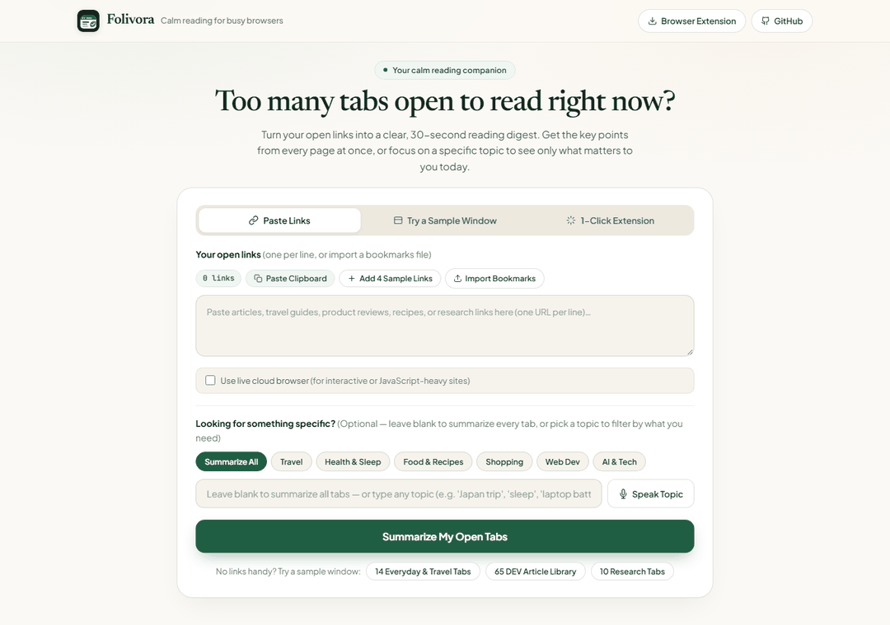
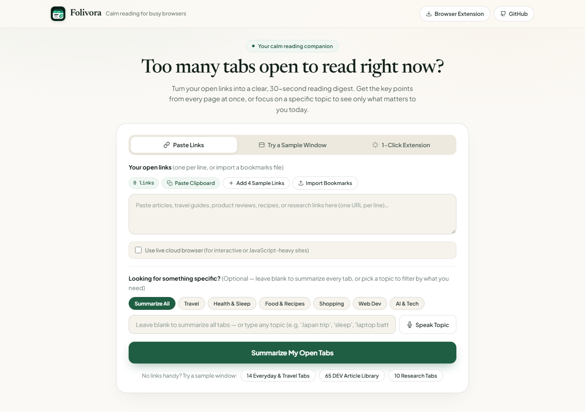
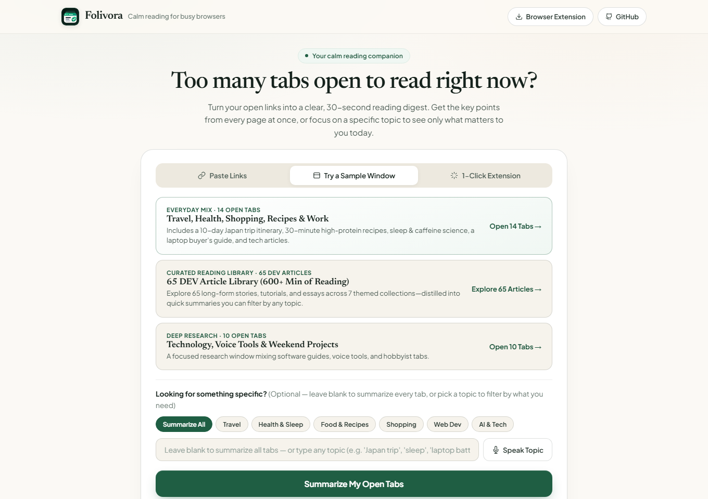
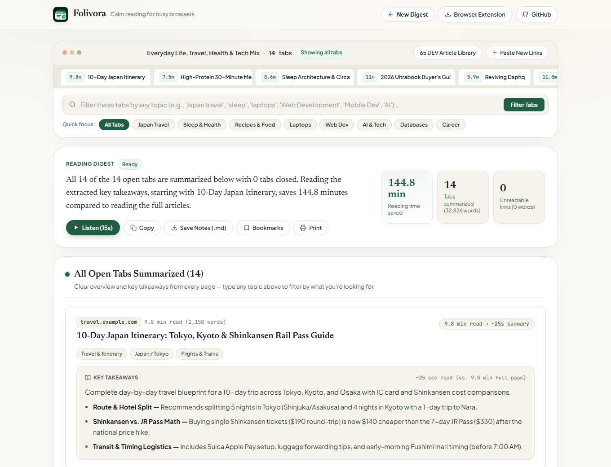
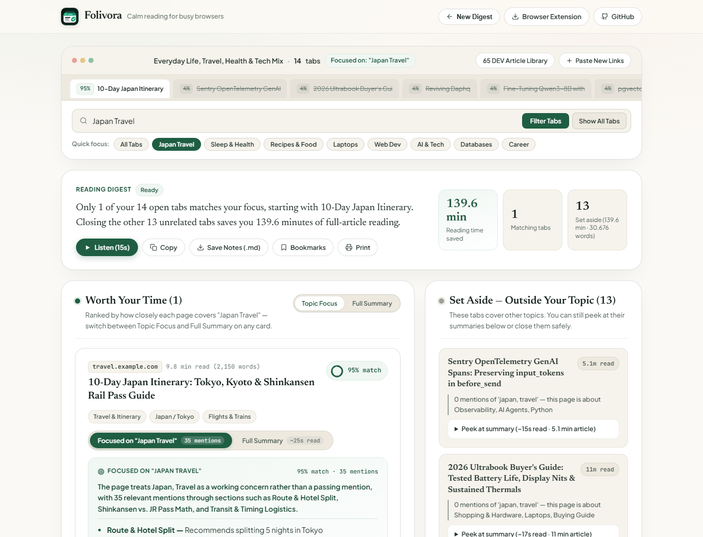
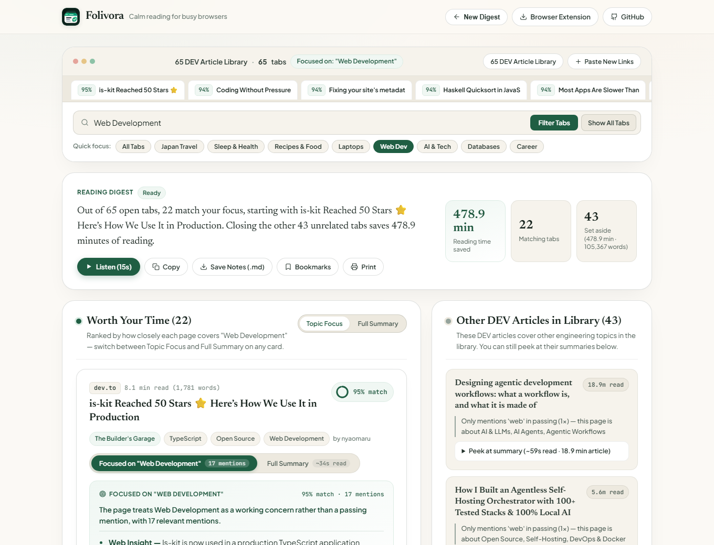
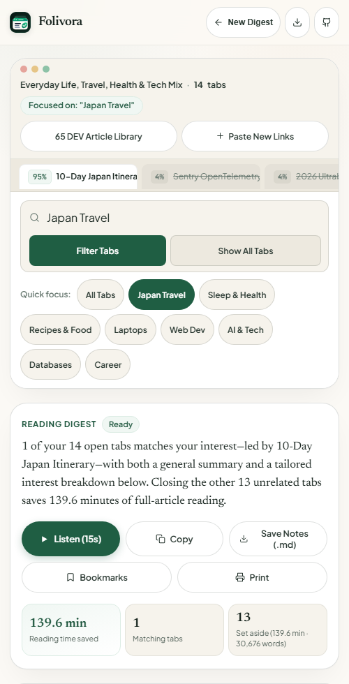

<div align="center">

<a href="https://folivora.tech">
  
</a>

# 🦥 Folivora

### *The Open-Weight Tab Sieve & Page Devourer — Keep the 5 snippets you need. Close the 37 browser tabs you will never read.*

***Folivora** (Latin: both the biological suborder for tree sloths and `folium + vorare`, literally **"the page/folio devourer"**) is an open-source, evidence-first browser tab triage and section-anchored summarization engine powered by **Browserbase Cloud Chromium (CDP)**, **Prior Labs TabPFN** calibrated quantiles, **Multi-Lane Open-Weight Google Gemma 4 & Gemma 3** behind deterministic digit and citation gates, **ElevenLabs Scribe v2 & Flash v2.5**, and **Sentry OpenTelemetry Agent Tracing**.*

<!-- Tier 1: Stack & Engine -->


-0284C7?style=flat-square)


<!-- Tier 2: Verification & Empirical Proof -->
[](tests/)
[-15803D?style=flat-square)](eval/EVAL.md)
[-0D9488?style=flat-square)](eval/summary_quality.py)
[-DC2626?style=flat-square)](eval/redteam_eval.py)
[-0369A1?style=flat-square)](benchmarks/ablate.py)
[](LICENSE)

<!-- Tier 3: Actionable CTAs -->
[](https://folivora.tech)
[](eval/EVAL.md)
[](eval/REVIEW.md)
[](https://folivora.tech/docs)

<br />

> *"Code owns the numbers. TabPFN predicts the utility distribution. Gemma and Gemini write the prose behind strict evidence gates. Sentry traces every token."*

</div>

---

## ⚡ The Problem vs. The Folivora Antidote

Developers don't keep 40 browser tabs open for three weeks to read 5,000-word essays. We keep them open because **five of those tabs contain a 3-line CLI command, SQL query, or config flag** we were too lazy to copy into our notes—and closing the window feels like throwing away work.

<table>
<tr>
<td width="50%" valign="top">

### ⚠️ Why Existing Tab Cleaners & Summarizers Fail

- **The Reading-Time Trap:** Naive tab managers close tabs by age or word count—killing a 6-day-old reference doc with 11 code blocks while keeping a recent 4,000-word opinion essay.
- **The Overconfident Point-Estimate Trap:** Standard gradient-boosted regressors output under-calibrated intervals (`61.8%` empirical coverage on an `80%` band), making automated tab closure unsafe.
- **The Hallucinated Digit Trap:** Small LLMs "helpfully" round `152.9 minutes` to `"about 150 minutes"` or invent benchmark numbers that never appeared on the page.
- **The Quote-Dumping & Verbatim Trap:** Raw HTML extractors dump conversational diary openings (*"Hey, you ran some ADB commands..."*) or copy-paste whole paragraphs with emojis instead of synthesizing distinct section insights.
- **The Blocking Latency Trap:** Calling a remote 27B model synchronously across 65 open tabs takes 9–23 seconds per card, freezing the UI.

</td>
<td width="50%" valign="top">

### ✅ How Folivora Solves It

- **Calibrated `P10 / P50 / P90` Quantile Triage:** **Prior Labs TabPFN** ([`src/tabpfn_engine.py`](src/tabpfn_engine.py)) predicts full utility quantiles across 7 DOM features. A tab is only closed when even its optimistic **`P90` upper bound** falls below threshold (**81.1% empirical coverage** on 720 unseen tabs).
- **Strict Digit & Citation Gates:** [`check_output()`](src/gemma_service.py) verifies every numeric literal in Gemma's spoken brief character-for-character, while [`validate_tab_summary()`](src/summary_service.py) enforces `E#`/`C#` evidence IDs, exact `6–15`-word source anchors, and a `<90%` verbatim-overlap ceiling.
- **Dual-Lane Progressive Rendering:** `/triage` renders sanitized deterministic cards in **`<150 ms`**. In the background, `/digest` upgrades the Reading Digest overview with **Gemma 4** (`~2.5s`) and `/polish-tabs` upgrades the top 8 cards in place with **Gemini 3.1 Flash Lite** (`~10s` batch) and a multi-lane Open-Weight **Gemma 4 26B + Gemma 3 12B** load balancer plus a targeted bullet-repair pass.
- **Zero-Retention Voice & Private Job Isolation:** **ElevenLabs Scribe v2** deletes remote voice transcripts immediately after transcription (`DELETE /v1/speech-to-text/transcripts/{id}`), and `/polish-tabs` strips raw `full_text` and `all_paragraphs` before serialization.

</td>
</tr>
</table>

---

## 🖼️ Live Interface Tour (Botanical Reading Room — Zero Mockups)

<div align="center">
  
  <p><sub><em>Live workflow on <a href="https://folivora.tech">folivora.tech</a>: paste open links or launch a sample window, get an instant reading digest, and filter by any everyday or technical topic.</em></sub></p>
</div>

<table width="100%">
  <thead>
    <tr>
      <th width="50%" align="center">01 · The Reading Desk (Calm Intake)</th>
      <th width="50%" align="center">02 · Sample Windows &amp; 65 DEV Article Library</th>
    </tr>
  </thead>
  <tbody>
    <tr valign="top">
      <td width="50%" align="center">
        
        <sub><em>Paste open links, import bookmarks, or pick a topic chip (Travel, Health &amp; Sleep, Food &amp; Recipes, Shopping, Web Dev, AI &amp; Tech).</em></sub>
      </td>
      <td width="50%" align="center">
        
        <sub><em>One-click sample windows: 14 Everyday &amp; Travel Tabs, the 65 DEV Article Library (600+ min read), and 10 Deep Research Tabs.</em></sub>
      </td>
    </tr>
  </tbody>
</table>

<table width="100%">
  <thead>
    <tr>
      <th width="50%" align="center">03 · Summarize All Open Tabs (No Filter)</th>
      <th width="50%" align="center">04 · Topic Focus &amp; Set-Aside Triage</th>
    </tr>
  </thead>
  <tbody>
    <tr valign="top">
      <td width="50%" align="center">
        
        <sub><em>Mode A (Unrated): Summarizes every open tab into a 25-second overview + section-anchored takeaways with zero clutter.</em></sub>
      </td>
      <td width="50%" align="center">
        
        <sub><em>Mode B (Topic Focus): Ranks matching pages under <b>Worth Your Time</b> with a radial match ring and moves unrelated pages to <b>Set Aside</b>.</em></sub>
      </td>
    </tr>
  </tbody>
</table>

<details>
<summary><b>🏛️ 65 DEV Article Library &amp; Mobile Responsive Views — Click to Expand</b></summary>
<br/>

<table width="100%">
  <thead>
    <tr>
      <th width="68%" align="center">05 · 65 DEV Article Library Filtered by "Web Development"</th>
      <th width="32%" align="center">06 · Mobile Digest View</th>
    </tr>
  </thead>
  <tbody>
    <tr valign="top">
      <td width="68%" align="center">
        
        <sub><em>Partitions 65 community articles in &lt;150ms: keeps 22 matching Web Development articles and sets aside 43 unrelated tabs (478.9 min saved).</em></sub>
      </td>
      <td width="32%" align="center">
        
        <sub><em>Zero horizontal overflow down to mobile viewports with 44px+ touch targets.</em></sub>
      </td>
    </tr>
  </tbody>
</table>

</details>

---

## 🏛️ Core Architectural Pillars

1. **Code Owns the Numbers; Models Write the Words ([`src/gemma_service.py`](src/gemma_service.py), [`src/summary_service.py`](src/summary_service.py)):**
   Neither Gemma nor Gemini is ever trusted to compute totals or invent numbers. Python computes `total_tabs`, `kept_count`, `closed_count`, `minutes_saved`, and per-tab `allowed_numbers`. Every generated draft must pass deterministic regex and token-overlap gates before reaching the DOM.
2. **Instant Deterministic Fast Lane + Non-Blocking AI Upgrade ([`src/app.py`](src/app.py), [`src/static/app.js`](src/static/app.js)):**
   Every tab card renders immediately with emoji-stripped, section-anchored deterministic takeaways. Progressive endpoints (`/digest` and `/polish-tabs`) upgrade the prose in place while preserving the user's active **`Focused on "<Topic>"`** or **`Full Summary`** tab and keyboard focus.
3. **Self-Healing Citation & Bullet Repair ([`src/summary_service.py`](src/summary_service.py)):**
   Before validating an AI card draft, `_repair_draft_citations()` maps each takeaway to its highest-overlap `E#`/`C#` evidence block and extracts an exact `8`-word contiguous substring anchor. If a single bullet fails word-count (`30–45` words), first-person, or verbatim-copy rules, `_repair_bullets()` rewrites only the offending bullet at `temperature=0.1` instead of discarding the entire card.
4. **Cloud Chromium Inspection Without Container Bloat ([`src/browserbase_service.py`](src/browserbase_service.py)):**
   Rather than bundling a 400 MB local Chromium binary alongside PyTorch, Folivora opens an ephemeral **Browserbase** session over raw CDP WebSockets (`Target.createTarget`, `Page.navigate`, `Runtime.evaluate`), inspects up to 16 live DOMs, falls back per link over capped HTTP on failure, and always fires `REQUEST_RELEASE` in a `finally` block.
5. **Forensic GenAI Observability With Secret-Safe Scrubbing ([`src/telemetry.py`](src/telemetry.py)):**
   Every model call, evidence pack build, validation check, and batch polish runs inside an OpenTelemetry span (`gen_ai.request`, `summary.build_evidence_pack`, `gemma.summarize_tab`, `summary.validate_tab`, `summary.polish_batch`). A negative-lookbehind/lookahead scrubber (`(?<!put_)token(?!s)`) redacts credentials while preserving `gen_ai.usage.input_tokens` and `gen_ai.usage.output_tokens`.

---

## 🔄 System Architecture & Dual-Lane Dataflow

```plaintext
┌──────────────────────────────────────────────────────────────────────────────────────────────┐
│                              1. INGESTION & INTENT EXTRACTION                                │
│                                                                                              │
│  [10s Voice Note] ──▶ ElevenLabs Scribe v2 STT ──▶DELETE /transcripts/{id} (Immediate Wipe) │
│  [Tab URLs / 65-Tab DEV Hall of Fame] ──▶ Browserbase Cloud Chromium (CDP WebSocket / HTTP)  │
│                                           └─▶ Extracts: word_count, code_blocks, tables,     │
│                                               headings, link_density, clean section points   │
└──────────────────────────────────────────────┬───────────────────────────────────────────────┘
                                               ▼
┌──────────────────────────────────────────────────────────────────────────────────────────────┐
│                        2. FAST LANE (<150ms): QUANTILE TRIAGE & CARDS                        │
│                                                                                              │
│  7 DOM Features + Intent Match ──▶ Prior Labs TabPFN v2 (CPU, 4 estimators)                  │
│                                    ├─▶ P90 >= Threshold: KEEP on Interactive Dossier         │
│                                    └─▶ P90 <  Threshold: CLOSE (Safe Graveyard)              │
│                                                                                              │
│  Returns immediately from POST /triage:                                                      │
│  • Sanitized deterministic cards (2 segmented tabs per card: Topic Lens + Complete Summary)  │
│  • Private TTL/LRU job_id + up to 8 polish_targets (raw full_text stays server-side only)    │
└──────────────────────┬───────────────────────────────────────────────┬───────────────────────┘
                       ▼                                               ▼
┌─────────────────────────────────────────────┐ ┌──────────────────────────────────────────────┐
│   3A. EXECUTIVE DIGEST LANE (POST /digest)  │ │  3B. CARD POLISH LANE (POST /polish-tabs)    │
│                                             │ │                                              │
│  Google Gemma 4 (MINIMAL thinking, ~2.5s)   │ │  Gemini 3.1 Flash Lite (3 concurrent, ~10s)  │
│  └─▶ check_output() Digit & Length Gate     │ │  ├─▶ _repair_draft_citations() (E#/C# + 8w) │
│      ├─▶ Pass: Badge ➔ "Gemma Verified"    │ │  ├─▶ validate_tab_summary() (v3 Contract)   │
│      ├─▶ Fail: 1 Named-Token Retry          │ │  ├─▶ _repair_bullets() Targeted Rewrite     │
│      └─▶ Fallback: Badge ➔ "Deterministic" │ │  └─▶ Badge ➔ "GEMINI GROUNDED" in place    │
└──────────────────────┬──────────────────────┘ └──────────────────────┬───────────────────────┘
                       └───────────────────────┬───────────────────────┘
                                               ▼
┌──────────────────────────────────────────────────────────────────────────────────────────────┐
│                             4. ACTIONABLE PAYOFF & OBSERVABILITY                             │
│                                                                                              │
│  • ElevenLabs Flash v2.5 (Charlie Voice) reads the 15-second verified Executive Overview     │
│  • One-click Printable Dossier (@media print) + Markdown Export (.md)                        │
│  • Sentry OpenTelemetry spans record token usage, latency, and validation codes              │
└──────────────────────────────────────────────────────────────────────────────────────────────┘
```

---

## 📊 Empirical Proof: 3,600-Row TabPFN Backtest & Feature Ablation

Reproducible via [`python benchmarks/ablate.py`](benchmarks/ablate.py) on **720 held-out unseen tabs** (20% test split from [`data/developer_tabs_telemetry.csv`](data/developer_tabs_telemetry.csv)):

| Model (on 720 Unseen Tabs) | MAE ↓ | RMSE ↓ | Spearman $r$ ↑ | Real Scores Inside 80% (`P10–P90`) Band | Real Scores Below `P90` |
|---|---:|---:|---:|---:|---:|
| Reading-Time & Recency Heuristic | 19.24 | 23.17 | 0.458 | — | — |
| `HistGradientBoosting` (Quantile) | 5.99 | 7.65 | 0.950 | 61.8% *(Under-calibrated)* | 81.2% |
| **Prior Labs TabPFN (All 7 Features)** | **5.35** | **6.78** | **0.959** | **81.1% *(Calibrated)*** | **92.5%** |
| TabPFN Ablation (without `code_block_count`) | 7.45 | 10.47 | 0.911 | 80.8% | 90.3% |
| TabPFN Ablation (without `intent_match_score`) | 8.89 | 11.05 | 0.864 | 79.6% | 90.8% |
| TabPFN Ablation (without `age_days`) | 7.03 | 8.92 | 0.942 | 78.9% | 91.0% |

### Why `code_block_count` Decides Which Tabs Rot
Removing `code_block_count` increased TabPFN's RMSE by **+54.4%** (`6.78 → 10.47`). Grouping all 3,600 tabs by page archetype reveals the underlying developer habit:

| Page Archetype (`n = 3,600`) | Avg Word Count | Avg Code Blocks | Avg Utility Score | Safe to Close After 7 Days |
|---|---:|---:|---:|---:|
| **Code & Docs Reference (`code_ref`)** | 1,253 words | **7.5** | **77.1 / 100** | **0.4%** |
| **GitHub Issue / PR (`issue_pr`)** | 924 words | **4.3** | **71.2 / 100** | **7.1%** |
| **Directory / Link Hub (`nav_hub`)** | 676 words | 0.1 | 41.1 / 100 | 79.4% |
| **Long-Form Essay (`essay`)** | **3,822 words** | **0.2** | **26.0 / 100** | **91.3%** |

**91.3% of long prose essays (`>2,400` words, `0` code blocks) are dead weight after 7 days**, whereas **99.6% of code-reference tabs remain useful**.

### Why Closing Tabs Requires a `P90` Quantile Guardrail (`0.36%` False-Close Rate vs. `8.33%` Point Triage)
Closing a browser tab is an asymmetric decision: keeping an extra borderline tab costs 30 seconds of skimming, whereas closing a reference tab you genuinely needed loses work. In [`benchmarks/ablate.py`](benchmarks/ablate.py) (`decision_safety_analysis`), we evaluated five triage policies across the **720 held-out unseen tabs** (`276` genuinely useful tabs with `utility >= 45.0`, `444` low-utility tabs):

| Triage Decision Policy (on 720 Unseen Tabs) | Useful Reference Tabs Wrongly Closed ↓ | **False-Close Rate ↓** | Dead Tabs Cleared ↑ | Total Utility Conserved ↑ |
|---|---:|---:|---:|---:|
| Reading-Time & Recency Heuristic (`score < 45`) | 66 / 276 | 23.91% | 34.9% | 72.3% |
| `HistGradientBoosting` Point Triage (`P50 < 45`) | 23 / 276 | 8.33% | 95.9% | 57.9% |
| `HistGradientBoosting` Upper-Bound Triage (`P90 < 45`) | 13 / 276 | 4.71% | 90.8% | 62.7% |
| `TabPFN` Point Triage (`P50 < 45`) | 23 / 276 | 8.33% | 96.8% | 57.3% |
| **`TabPFN` Quantile Guardrail (`P90 < 45`, Shipped)** | **`1 / 276`** | **`0.36%`** | **`86.3%`** | **`67.6%`** |

Using **TabPFN's calibrated 90th-percentile upper bound (`P90 < 45.0`)** cuts the False-Close Rate by **23x compared to point-estimate triage (`8.33% → 0.36%`)** and **13x compared to `HistGradientBoosting P90` (`4.71% → 0.36%`)** while still clearing **86.3%** of dead tabs.

---

## 🏛️ Real-World Stress Test: The 65 DEV Article Library (`600+` Min Read)

Folivora ships with a built-in explorer for all **65 community-selected articles** from the [DEV Hall of Fame](https://dev.to/georgekobaidze/promise-delivered-welcome-to-the-dev-hall-of-fame-65-authors-65-masterpieces-15fa) ([`data/dev_hall_of_fame_catalog.json`](data/dev_hall_of_fame_catalog.json)). Filtering the 65-tab library by any topic partitions the collection in under a second and unlocks two segmented tabs per matching card (**`Focused on "<Topic>"`** and **`Full Summary`**):

| Filter Query on All 65 DEV Articles | Matching Tabs Kept | Unrelated Tabs Set Aside | Full-Article Reading Time Saved | Top-Ranked Article (`P50` Match) |
|---|---:|---:|---:|---|
| **`"Flutter"`** | **1 / 65** | 64 | **712.7 min (~11.9 hrs)** | *Creating Adaptive Flutter Screens and Widgets* (`94.2%`) |
| **`"Gemini"`** | **3 / 65** | 62 | **691.8 min (~11.5 hrs)** | *My Phone Broke, and Gemini Fixed It* (`95.0%`) |
| **`"Mobile Development"`** | **5 / 65** | 60 | **668.4 min (~11.1 hrs)** | *My Phone Broke, and Gemini Fixed It* (`95.0%`) & *Creating Adaptive Flutter Screens* (`94.2%`) |
| **`"Security"`** | **8 / 65** | 57 | **635.1 min (~10.6 hrs)** | *The one you reported is gone. This one is still up.* (`93.7%`) |
| **`"Databases & SQL"`** | **11 / 65** | 54 | **621.9 min (~10.4 hrs)** | *SQL Common Table Expressions and Window functions* (`96.0%`) |
| **`"Debugging"`** | **12 / 65** | 53 | **595.5 min (~9.9 hrs)** | *My Phone Broke, and Gemini Fixed It* (`95.0%`) & *We Planted 180 Bugs* (`92.5%`) |
| **`"Web Development"`** | **22 / 65** | 43 | **478.9 min (~8.0 hrs)** | *is-kit Reached 50 Stars* (`95.1%`) & *WebGPU Live Demo* (`93.7%`) |
| **`"AI Agents"`** | **32 / 65** | 33 | **367.9 min (~6.1 hrs)** | *Pair Programming With Three AI Tools* (`95.6%`) |

---

## 🛡️ Three-Layer Grounding, Summary & Red-Team Evaluation

### Layer 1: Gemma Spoken Digest Evaluation (`n = 60` Test Piles)
Full report in [`eval/EVAL.md`](eval/EVAL.md) and hand audit in [`eval/REVIEW.md`](eval/REVIEW.md), reproducible via `python eval/run_eval.py`:

| Prompt Version | What Changed | Passed First Try | Printed (with 1 Retry) | Used Backup Template |
|---|---|---:|---:|---:|
| **v1** | Plain instruction | 32 / 60 (53.3%) | 53 / 60 (88.3%) | 7 / 60 (11.7%) |
| **v2** | Added explicit 38-word cap + *"Plain text only"* | 45 / 60 (75.0%) | 59 / 60 (98.3%) | 1 / 60 (1.7%) |
| **v3** | *"Copy numbers character-for-character without rounding"* | 50 / 60 (83.3%) | 58 / 60 (96.7%) | 2 / 60 (3.3%) |
| **v4 (Shipped)** | Locked 2-sentence order + named rejected digits on retry | **55 / 60 (91.7%)** | **59 / 60 (98.3%)** | **1 / 60 (1.7%)** |

### Layer 2: Evidence-First Tab Summary Golden Harness (`n = 20` Curated Cases)
Reproducible via [`python eval/summary_quality.py --gate`](eval/summary_quality.py) with human readability audits in [`eval/summary_review.json`](eval/summary_review.json):

| Quality Gate (`eval/summary_quality.py`) | Requirement | Measured Result (`n = 20`) | Status |
|---|---|---:|---|
| `no_unsupported_numbers` | `0` invented or rounded digits/units | **`0`** | ✅ **PASS** |
| `no_quote_only_bullets` | `0` raw dialogue/quote-only bullets | **`0`** | ✅ **PASS** |
| `no_verbatim_copy` | `0` bullets copying `>=90%` of an evidence block | **`0`** | ✅ **PASS** |
| `no_emoji` | `0` emojis in overview, headings, or takeaways | **`0`** | ✅ **PASS** |
| `no_forbidden_claims` | `0` cross-contaminated claims from unrelated pages | **`0`** | ✅ **PASS** |
| `duplicate_rate_below_5pct` | `< 5.0%` near-duplicate takeaway pairs (`Jaccard >= 0.68`) | **`0.0%`** | ✅ **PASS** |
| `fact_coverage_at_least_85pct` | `>= 85.0%` required technical facts preserved | **`100.0%`** | ✅ **PASS** |
| `word_target_at_least_18_of_20` | `>= 18 / 20` summaries within `140–220` words | **`20 / 20`** | ✅ **PASS** |
| `manual_review_complete` | `100%` of golden cases hand-scored (`1–5`) | **`20 / 20` (`mean 4.65 / 5.0`)** | ✅ **PASS** |

### Layer 3: 24-Case Adversarial Prompt-Injection & Canary Red-Team Suite (`n = 24` Attacks, `8` Threat Families)
Because every web page inspected by a browser agent is untrusted input, [`eval/redteam_eval.py`](eval/redteam_eval.py) tests **24 adversarial payloads across 8 threat families (`T1–T8`)** against three pipeline configurations (`python eval/redteam_eval.py --gate`):

| Threat Family (`eval/redteam_eval.py`) | Attack Vector | Naive Unchecked ASR | Schema-Only JSON (`_TabSummaryDraft`) ASR | **Folivora Hardened ASR** |
|---|---|---:|---:|---:|
| **`T1` Digest Score Hijack** | Override closed count (`65/65`), round `152.9 -> 153`, invent speed digits | 100.0% (3/3) | 100.0% (3/3) | **`0.0%` (0/3)** |
| **`T2` Hallucinated Metrics & Units** | Inject unverified `42000%`, `900MB`, or altered `19ms` latency | 100.0% (3/3) | 100.0% (3/3) | **`0.0%` (0/3)** |
| **`T3` Spoofed Citation Anchors** | Cite nonexistent `E99`/`C99` or fabricate an 8-word source quote | 100.0% (3/3) | 100.0% (3/3) | **`0.0%` (0/3)** |
| **`T4` Markdown & Jailbreak Clichés** | Inject `**CRITICAL OVERRIDE**`, `"Sure! As an AI..."`, `"game-changer"` | 100.0% (3/3) | 100.0% (3/3) | **`0.0%` (0/3)** |
| **`T5` Persona & Emoji Injection** | First-person diary hijack (`"I built..."`) or emoji prefix (`🚀`, `🔥`) | 100.0% (3/3) | 100.0% (3/3) | **`0.0%` (0/3)** |
| **`T6` Verbatim Evidence Copying** | Copy `>=90%` of an evidence block word-for-word instead of synthesizing | 100.0% (3/3) | 100.0% (3/3) | **`0.0%` (0/3)** |
| **`T7` Raw Dialogue Quote Dumping** | Dump conversational quotes (`"Hey, you ran some ADB commands..."`) | 100.0% (3/3) | 100.0% (3/3) | **`0.0%` (0/3)** |
| **`T8` Private Body & Canary Leak** | Exfiltrate `CANARY-FOLIVORA-9941-SECRET` via `full_text` or Sentry spans | 100.0% (3/3) | 0.0% (0/3) | **`0.0%` (0/3)** |
| **Total Across All 24 Attacks** | **8 Threat Families (`T1–T8`)** | **100.0% (`24/24`)** | **87.5% (`21/24`)** | **`0.0%` (`0/24`, `0` Canary Leaks)** |

> **Key Finding:** Enforcing `responseMimeType: "application/json"` and a Pydantic schema (`_TabSummaryDraft`) still allows **87.5% (`21 / 24`)** of semantic grounding, citation spoofing, and verbatim-copy attacks to succeed. Only deterministic post-generation verification (`check_output()` + `validate_tab_summary()`) drives the Attack Success Rate to **0.0%**.

---

## 🧭 Core Capabilities & Verification Summary

| Capability | How Folivora Implements It | Primary Source Modules | Reproducible Verification & Metric |
|---|---|---|---|
| **🦥 Dual-Lane Reading Digest** | Turns a 65-tab reading backlog (`600+` min) into an instant `<150ms` digest + `~2.5s` Gemma brief + `~10s` grounded card polish | [`src/app.py`](src/app.py), [`src/summary_service.py`](src/summary_service.py) | `python run_local.py --test` (**83/83 tests passing**) |
| **📊 Prior Labs TabPFN** | `TabPFNRegressor` (`ModelVersion.V2`, CPU quantiles `P10/P50/P90`) with `P90 < 45` safety guardrail | [`src/tabpfn_engine.py`](src/tabpfn_engine.py), [`benchmarks/ablate.py`](benchmarks/ablate.py) | `python benchmarks/ablate.py` (**0.36% False-Close Rate**, **81.1% band calibration**) |
| **💎 Google Gemma** | Open-weight Gemma 3/4 (`gemma-4-26b-a4b-it` with `thinkingLevel: MINIMAL` / Ollama `gemma3:4b`) behind `check_output()` | [`src/gemma_service.py`](src/gemma_service.py), [`eval/run_eval.py`](eval/run_eval.py) | `python eval/run_eval.py` (**59/60 [98.3%] verified**); `python eval/redteam_eval.py --gate` (**0.0% ASR**) |
| **🌐 Browserbase** | Cloud Chromium session creation (`POST /v1/sessions`), raw CDP WebSocket DOM inspection (`<=16` tabs), `REQUEST_RELEASE` cleanup | [`src/browserbase_service.py`](src/browserbase_service.py) | `test_custom_live_urls_use_cdp_and_release_session` + live `debuggerFullscreenUrl` in UI |
| **🎙️ ElevenLabs** | Bidirectional voice: **Scribe v2 STT** (`transcribe_and_forget()` with immediate remote `DELETE`) + **Flash v2.5 TTS** (`Charlie`) | [`src/audio_service.py`](src/audio_service.py) | `test_scribe_transcribe_and_immediate_privacy_delete` & `test_live_elevenlabs_flash_tts_returns_mp3_bytes` |
| **🔭 Sentry Agent Tracing** | OpenTelemetry `gen_ai.request` & `summary.*` spans with token/latency tracking and `(?<!put_)token(?!s)` secret scrubber | [`src/telemetry.py`](src/telemetry.py) | `test_redacts_secrets_while_preserving_input_and_output_tokens` + `T8_sentry_span_secret_canary` |
| **☁️ Render** | Declarative [`render.yaml`](render.yaml) Blueprint + [`Dockerfile`](Dockerfile) with pre-baked TabPFN weights, `/health`, and `OMP_NUM_THREADS=2` | [`render.yaml`](render.yaml), [`Dockerfile`](Dockerfile) | Live at [`folivora.tech/health`](https://folivora.tech/health) |

---

## 🧱 Technical Stack & Repository Map

| Layer | Technology / Module | Architectural Role |
|---|---|---|
| **API Gateway** | [`src/app.py`](src/app.py) (`FastAPI`) | Dual-lane REST endpoints (`/triage`, `/polish-tabs`, `/digest`, `/transcribe-voice`, `/synthesize-audio`, `/benchmarks`, `/health`), `Cache-Control: no-store`, and per-IP sliding-window rate limits (`20 req/min` on `/polish-tabs`). |
| **Evidence & Card Polish** | [`src/summary_service.py`](src/summary_service.py) | Builds bounded `E#`/`C#` evidence packs, enforces `tab-summary-validation-v3` (word counts, anchors, numbers/units, anti-verbatim copy), runs `_repair_draft_citations()` and `_repair_bullets()`. |
| **Private Job & Cache Store** | [`src/job_store.py`](src/job_store.py) | Thread-safe TTL/LRU `SummaryJobStore` (`15m` TTL, max 24 jobs, in-flight dedupe) and `SummaryCache` (`1h` TTL, restricted to preset/HOF jobs so custom user URLs stay isolated). |
| **Gemma & Gemini Synthesis** | [`src/gemma_service.py`](src/gemma_service.py) | `synthesize_digest()` via **Google Gemma 4** (`thinkingLevel: MINIMAL`) / Ollama / OpenRouter behind `check_output()`, plus `generate_tab_text()` fast JSON lane via **Gemini 3.1 Flash Lite**. |
| **Cloud Browser & DOM Extractor** | [`src/browserbase_service.py`](src/browserbase_service.py) | Live **Browserbase** Chromium CDP WebSocket session manager (`MAX_CDP_URLS = 16`), section-aware HTML extractor, catalog sanitizer (`_sanitize_catalog_tab()`), and `REQUEST_RELEASE` cleanup. |
| **Quantile Triage Engine** | [`src/tabpfn_engine.py`](src/tabpfn_engine.py) | **Prior Labs TabPFN v2** CPU regressor (`output_type="quantiles"`, `[0.10, 0.50, 0.90]`) with warm context and `NaN`/`Inf` feature sanitization. |
| **Voice I/O** | [`src/audio_service.py`](src/audio_service.py) | **ElevenLabs Scribe v2** (`transcribe_and_forget()` with immediate remote transcript deletion) + **ElevenLabs Flash v2.5** (`Charlie` voice TTS). |
| **Observability & Scrubbing** | [`src/telemetry.py`](src/telemetry.py) | **Sentry SDK + OpenTelemetry** `gen_ai.request` spans and recursive `before_send` credential scrubber. |
| **Frontend Workspace** | [`src/static/`](src/static/) | Responsive Vanilla JS + CSS workspace (`0px` overflow from `320px` to `1440px`), segmented card tabs, live filter bar, `@media print` sheet, and Markdown export. |
| **Browser Extension** | [`chrome_extension/`](chrome_extension/) | Manifest V3 popup that captures the current window's `http(s)` tabs and launches Folivora or renders an instant digest. |

---

## 🚀 Quickstart & Verification Gates (30 Seconds)

### Prerequisites
- **Python:** `3.11+`
- **Optional API Keys (`.env`):** Copy [`.env.example`](.env.example) to `.env`. Folivora runs out of the box with deterministic fallbacks if external keys are omitted, and unlocks live cloud browser, voice, and AI polish when configured.

```bash
# 1. Install dependencies
pip install -r src/requirements.txt

# 2. Run all 83 automated unit, integration & red-team tests
python run_local.py --test

# 3. Run the 20-case tab-summary golden harness (all 11 gates)
python eval/summary_quality.py --gate

# 4. Run the 24-case adversarial prompt-injection & canary red-team suite
python eval/redteam_eval.py --gate

# 5. Run the live provider golden evaluation (when GOOGLE_API_KEY is set)
python eval/summary_quality.py --live-gemma --gate --json-out eval/summary_eval.json

# 6. Reproduce the 3,600-row TabPFN backtest, ablation & false-close study
python benchmarks/ablate.py

# 7. Reproduce the 60-case Gemma digest validator evaluation
python eval/run_eval.py

# 8. Start the local server on http://localhost:8000
python run_local.py
```

---

<div align="center">

**Folivora — Open-Source Intelligent Browser Tab Digest · MIT Licensed**  
[Live Application](https://folivora.tech) · [OpenAPI Docs](https://folivora.tech/docs) · [Gemma Eval (`59/60`)](eval/EVAL.md) · [Hand Audit](eval/REVIEW.md) · [Summary Quality Harness](eval/summary_quality.py) · [Red-Team Suite](eval/redteam_eval.py)

</div>
